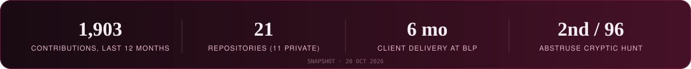
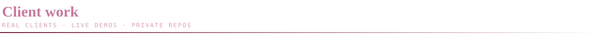
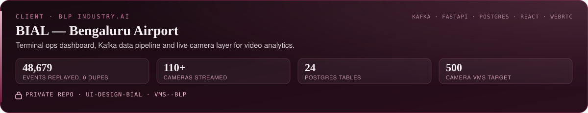
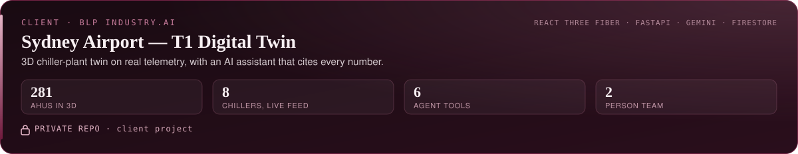
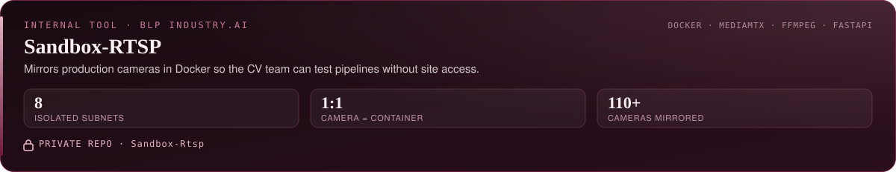
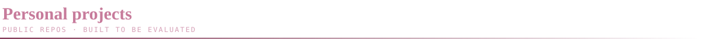
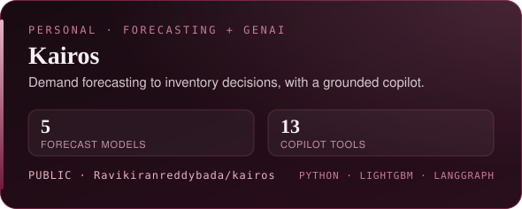
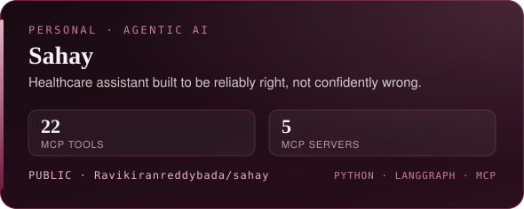
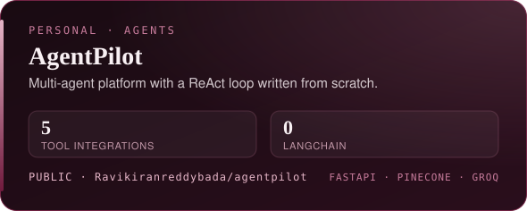
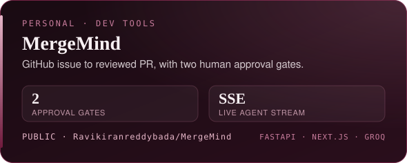

 

**I build AI agents and data systems that survive real clients.** At BLP Industry.AI I work like a forward-deployed engineer. I build the pipeline, backend, agent and UI, then demo it live. Final-year B.Tech CSE (AI & ML) at NIIT University. Open to AI/ML, data and backend roles from Jan 2027.

 

Client and employer work, so the repos are private. Sydney was a team of two. At BIAL, the DeepStream models belong to a teammate. I built the dashboard, APIs, databases and streaming around them. Happy to walk through any of it live.

  

<table>
<tr>
<td width="50%"></td>
<td width="50%"></td>
</tr>
<tr>
<td width="50%"></td>
<td width="50%"></td>
</tr>
</table>

Kairos runs on a synthetic retail dataset. Sahay evals run on the offline engine. Also: [DermaSmart](https://github.com/Ravikiranreddybada/dermasmart), an AI skin-analysis pipeline where images never touch disk.

 

### 🏆 Recognition

🥈 **2nd of 96** · Abstruse cryptic hunt / CTF, siNUsoid vX, NIIT University (2026) &nbsp;·&nbsp; ☁️ **AWS Certified Cloud Practitioner** (Jun 2025)

### 🧰 Toolkit

 

