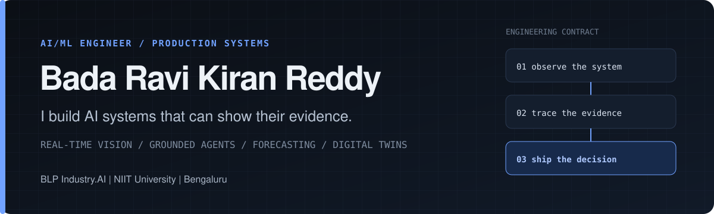

<p align="center">
  <a href="https://ravikiranreddy.online"><b>Portfolio</b></a>&nbsp;&nbsp;/&nbsp;&nbsp;
  <a href="https://linkedin.com/in/ravikiranreddybada"><b>LinkedIn</b></a>&nbsp;&nbsp;/&nbsp;&nbsp;
  <a href="mailto:badaravikiranreddy@gmail.com"><b>Email</b></a>&nbsp;&nbsp;/&nbsp;&nbsp;
  <a href="https://github.com/Ravikiranreddybada?tab=repositories"><b>Repositories</b></a>
</p>

I am an **AI/ML Engineering Intern at BLP Industry.AI**, building production systems for airport operations in Bengaluru and Sydney. I work across the full path: models, event pipelines, APIs, agent safety, cloud deployment and the interface an operator trusts.

I do not treat an LLM response as an answer just because it sounds correct. My systems trace numbers to tools, attach uncertainty to forecasts, require confirmation before writes and replay production conditions before deployment.

<table>
  <tr>
    <td><b>113</b><br/><sub>camera streams in the BIAL analytics pipeline</sub></td>
    <td><b>A$72,072/yr</b><br/><sub>identified Sydney T1 energy savings</sub></td>
    <td><b>36 / 36</b><br/><sub>Kairos copilot eval gate</sub></td>
    <td><b>123</b><br/><sub>Sahay integration and system tests</sub></td>
  </tr>
</table>

## Production work

<table>
  <tr>
    <td width="50%" valign="top">
      <h3>Bengaluru International Airport</h3>
      <p><b>Terminal operations and video analytics</b></p>
      <p>113 RTSP cameras flow through NVIDIA DeepStream, YOLO tracking and Kafka into TimescaleDB. Live occupancy, wait-time and overcrowding analytics reach operators through FastAPI and WebSockets.</p>
      <p>A deterministic replay rig mirrors every camera on its real IP across 8 subnets. It caught <b>3 silent defects</b> before deployment.</p>
      <code>DeepStream</code> <code>Kafka</code> <code>FastAPI</code> <code>TimescaleDB</code>
    </td>
    <td width="50%" valign="top">
      <h3>Sydney Airport T1</h3>
      <p><b>Chiller plant digital twin and AI assistant</b></p>
      <p>An 8-month audit of 15-minute BMS telemetry produced 6 Energy Conservation Measures.</p>
      <p>The production twin combines a grounded multi-model Plant Assistant, Gemini Live voice and an interactive React Three Fiber plant on Google Cloud.</p>
      <code>BigQuery</code> <code>Gemini</code> <code>Three.js</code> <code>Cloud Run</code>
    </td>
  </tr>
</table>

## Systems I built to be questioned

<table>
  <tr>
    <td width="50%" valign="top">
      <h3><a href="https://github.com/Ravikiranreddybada/kairos">Kairos</a></h3>
      <p><b>Supply-chain decision intelligence</b></p>
      <p>Probabilistic forecasts become inventory policy, stress-tested decisions and grounded answers for planners.</p>
      <ul>
        <li>LightGBM champion: WAPE 0.324 / MASE 0.726</li>
        <li>82.8% coverage on 80% conformal intervals</li>
        <li>13 typed tools, hybrid RAG and guarded text-to-SQL</li>
        <li>105 tests, Kubernetes and Prometheus/Grafana</li>
      </ul>
      <p><sub>Forecast metrics use the reproducible synthetic benchmark dataset.</sub></p>
      <p><a href="https://kairos-web-mu.vercel.app"><b>Live demo</b></a> &nbsp;|&nbsp; <a href="https://github.com/Ravikiranreddybada/kairos"><b>Source</b></a></p>
    </td>
    <td width="50%" valign="top">
      <h3><a href="https://github.com/Ravikiranreddybada/sahay">Sahay</a></h3>
      <p><b>Grounded multi-agent healthcare assistant</b></p>
      <p>Safety and authorization live in the runtime, not in a hopeful prompt. Designed to serve 1 lakh daily users.</p>
      <ul>
        <li>22 tools across 5 authenticated MCP servers</li>
        <li>Zero-LLM emergency triage in 3 languages</li>
        <li>141 counterfactual fairness runs and 123 tests</li>
        <li>Human confirmation before every write action</li>
      </ul>
      <p><sub>Measured cost: ₹2.3 per conversation.</sub></p>
      <p><a href="https://sahay-web-nu.vercel.app"><b>Live demo</b></a> &nbsp;|&nbsp; <a href="https://github.com/Ravikiranreddybada/sahay"><b>Source</b></a></p>
    </td>
  </tr>
</table>

## Capability map

| I use this | To solve this |
|---|---|
| **LangGraph, MCP, Claude, Gemini, hybrid RAG** | Grounded agents, controlled tool use, evaluation and graceful fallback |
| **LightGBM, scikit-learn, SHAP, statsmodels** | Forecasting, uncertainty, explanations and anomaly detection |
| **FastAPI, Kafka, PostgreSQL, TimescaleDB, Redis** | Event-driven services, time-series data and durable agent state |
| **DeepStream, YOLO, RTSP, MediaMTX, WebRTC** | Multi-camera inference, live video and deterministic regression testing |
| **React, Next.js, TypeScript, Three.js** | Operator interfaces, product surfaces and interactive digital twins |
| **Docker, Kubernetes, Terraform, OpenTelemetry** | Repeatable delivery, autoscaling, infrastructure and observability |

## Contribution signal

<a href="https://github.com/Ravikiranreddybada?tab=overview">
  <picture>
    <source media="(prefers-color-scheme: dark)" srcset="https://github-readme-activity-graph.vercel.app/graph?username=Ravikiranreddybada&amp;bg_color=0b0f15&amp;color=98a5b5&amp;line=71a2ff&amp;point=edf2f7&amp;area=true&amp;area_color=71a2ff&amp;hide_border=true&amp;hide_title=true" />
    <source media="(prefers-color-scheme: light)" srcset="https://github-readme-activity-graph.vercel.app/graph?username=Ravikiranreddybada&amp;bg_color=ffffff&amp;color=566171&amp;line=1457d9&amp;point=1457d9&amp;area=true&amp;area_color=1457d9&amp;hide_border=true&amp;hide_title=true" />
    
  </picture>
</a>

## Engineering contract

```text
observe the real system
        |
        v
trace every decision to evidence
        |
        v
test the failure path, not only the demo
        |
        v
ship something an operator can defend
```

<details>
<summary><b>Education and recognition</b></summary>
<br/>

- B.Tech, Computer Science and Engineering (AI & ML), NIIT University, 2023-2027
- 2nd place out of 96, Abstruse cryptic hunt and CTF, siNUsoid vX, 2026
- AWS Certified Cloud Practitioner, Jun 2025

</details>

<br/>

<p align="center">
  <b>Open to AI/ML, GenAI and forward-deployed engineering roles for the 2027 batch.</b><br/>
  <sub>If the work needs to be explainable, observable and production-ready, I want to build it.</sub>
</p>
