## 👋 About

I am a final-year **B.Tech CSE (AI & ML)** student at **NIIT University** (batch of 2027). I work as a **Data Science Intern at BLP Industry.AI** in Bengaluru. There I work like a forward-deployed engineer: I build the data pipeline, the backend, the AI agent and the UI for real client projects, then **demo it live to the client**.

I like systems that are *reliably right*, not just impressive. My agents must show where each number came from. My pipelines must survive a crash and a replay. I write specs and decision logs first, then build with AI coding agents (Claude Code is my main tool) and check every change with tests and evals.

> 📍 Bengaluru, India · 🔭 Open to **AI/ML, data and backend** roles from Jan 2027 · 🌐 [ravikiranreddy.online](https://www.ravikiranreddy.online)

---

## 🏢 Client work at BLP Industry.AI

These projects are **client and employer work**. The repositories are **private**, so the links below show *Private repo* instead of a clickable link. I can walk through the design and code in an interview.

### ✈️ BIAL — Bengaluru International Airport · Terminal ops & video analytics
> A new operations UI, data pipelines and a camera-streaming layer around the airport's video-analytics (DeepStream) system.

- **AODB Kafka pipeline:** Python producer → Kafka (KRaft) → consumer → **24 PostgreSQL tables**. Upsert by entity Id, offsets committed with the DB write. Verified on **48,679 messages / 23 message types**; a second full replay created **zero new rows**.
- **QMS live engine:** ported a ~750-line JavaScript analytics engine to a Python `asyncio` task in FastAPI. It raises queue alerts (long wait, unmanned counter, overcrowding) and pushes updates over WebSockets.
- **Control-room dashboard:** React 19 + Vite, light/dark themes, built from scratch. Includes a **camera ROI editor** that draws polygons over a live RTSP preview, so the CV team can configure DeepStream regions.
- **RTSP streaming layer:** MediaMTX config generator, 110+ cameras, H.264 pass-through to WebRTC/HLS with **zero transcoding**. The browser never sees raw camera URLs or credentials.
- **Multi-tenant VMS:** FastAPI + Postgres **row-level security**, ONVIF discovery, PTZ control with role arbitration, recording, playback and export, and a small Go subnet-probe agent. Designed for a 500-camera target.
- **My part:** dashboard, APIs, databases, streaming and ROI tooling. The DeepStream models and pipeline code belong to a teammate.
- **Stack:** `Python` `Kafka` `FastAPI` `PostgreSQL` `SQLAlchemy` `Alembic` `React` `TypeScript` `Docker` `MediaMTX` `WebRTC` `Go`
- **Repos:** 🔒 Private repo — `UI-DESIGN-BIAL`, `VMS--BLP`

### 🛫 Sydney Airport — Terminal 1 chiller plant digital twin
> An interactive 3D twin of a real chiller plant, with real building-system telemetry and a grounded AI Plant Assistant. Built by a **team of two**.

- **3D plant** in React Three Fiber: 8 chillers, 7 cooling-tower cells, 20 pumps, 281 AHUs. The layout follows the client's official drawing sheets.
- **AI Plant Assistant:** Gemini with tool calling (6 tools). Rule: *every number must come from a tool result*, otherwise it says the data is not available. It can also move the 3D camera and take voice input through short-lived, single-use tokens, so the API key never reaches the browser.
- **Data Availability ingest:** daily job that pages a 15,000-row-per-call history API with a cursor and overlap, de-duplicates, and flags `missing`, `partial`, `stale` and `out_of_range` data per asset per day. Equipment with no feed shows "no feed" — no fake data.
- **My part:** all UI/UX, the 3D plant, the assistant and voice, and the availability pipeline. My teammate built the BigQuery sync and most of the energy-audit findings.
- **Stack:** `React 19` `TypeScript` `Three.js` `R3F` `FastAPI` `Firestore` `Gemini` `Docker` `Cloud Run`
- **Repo:** 🔒 Private repo (client project)

### 🎥 Sandbox-RTSP — camera mirror for the CV team
> Each production camera becomes its own Docker container that holds the real IP and port, so DeepStream pipelines can be tested without site access.

- One MediaMTX + FFmpeg container per camera on an isolated bridge network per subnet (8 subnets). Stop and start a camera from the UI to test **reconnect behaviour**.
- **Stack:** `FastAPI` `Docker SDK` `PostgreSQL` `React` `MediaMTX` `FFmpeg`
- **Repo:** 🔒 Private repo — `Sandbox-Rtsp` (internal tool)

---

## 🚀 Personal projects

### 📈 [Kairos](https://github.com/Ravikiranreddybada/kairos) — demand forecasting and decision copilot
Probabilistic forecasting → inventory policy → an AI copilot whose every number traces to a tool call and a model run.
- Five forecast models (LightGBM, ETS, Croston-TSB…), rolling-origin backtests, conformal intervals, Diebold–Mariano model gates, SHAP drivers.
- LangGraph copilot with 13 read-only tools, hybrid RAG, a sandboxed text-to-SQL guard and a numeric grounding verifier.
- *Results are on a synthetic retail dataset.* · `Python` `LightGBM` `LangGraph` `DuckDB` `MCP` `FastAPI`

### 🩺 [Sahay](https://github.com/Ravikiranreddybada/sahay) — grounded multi-agent healthcare assistant
An assistant that is *reliably right instead of confidently wrong*.
- LangGraph agent with human-in-the-loop confirmation, 5 MCP servers (22 tools), emergency triage with no LLM call, PII redaction.
- Eval suite with hard gates (confirmation accuracy, emergency recall, zero cross-user leaks) and a counterfactual-fairness suite.
- *Evals run on the offline engine.* · `Python` `LangGraph` `MCP` `Next.js` `Docker`

### 🤖 [AgentPilot](https://github.com/Ravikiranreddybada/agentpilot) · ⚙️ [MergeMind](https://github.com/Ravikiranreddybada/MergeMind) · 🔬 [DermaSmart](https://github.com/Ravikiranreddybada/dermasmart)
| Project | What it is | Stack |
|---|---|---|
| **AgentPilot** | Multi-agent platform with a ReAct loop written from scratch, no LangChain. RAG plus 5 tool integrations. | `FastAPI` `Pinecone` `MongoDB` `Groq` |
| **MergeMind** | GitHub issue → reviewed PR agent with live streaming and two human approval gates. | `FastAPI` `Next.js` `Groq` `SSE` |
| **DermaSmart** | 4-stage safe pipeline for skin-condition analysis. Images stay in memory, never on disk. | `TensorFlow` `MobileNetV2` `OpenCV` `Gemini` |

---

## 🏆 Achievements

- 🥈 **2nd place of 96 participants** — Abstruse, 2-day cryptic hunt / CTF, siNUsoid vX, NIIT University (2026)
- ☁️ **AWS Certified Cloud Practitioner** — Amazon Web Services (June 2025)
- 🎤 Gave **multiple live client demos** at BLP Industry.AI

---

## 🧰 Skills

| Area | Tools |
|---|---|
| **Languages** | Python · TypeScript / JavaScript · SQL · Go (basic) |
| **GenAI & agents** | LangGraph · tool calling · MCP · RAG (BM25 + dense + RRF) · LLM evals · guardrails · Claude, Gemini, Groq |
| **ML & data** | pandas · scikit-learn · LightGBM · statsmodels · time-series forecasting · SHAP · TensorFlow · OpenCV |
| **Backend & data eng.** | FastAPI · asyncio · WebSockets · Kafka · PostgreSQL · SQLAlchemy · Alembic · Redis · BigQuery · Firestore |
| **Video & infra** | RTSP · ONVIF · MediaMTX · WebRTC · FFmpeg · Docker · GitHub Actions · MLflow · Prometheus |
| **Frontend & 3D** | React · Next.js · Tailwind · Three.js · React Three Fiber · Zustand |
| **AI-assisted dev** | Claude Code (CLAUDE.md, custom skills, worktrees) · Codex · Cursor · Ollama · spec-driven work with ADRs |

---

## 📊 GitHub activity

Live public contribution graph. Most client work lives in private repos, so it is not fully shown here.

---

[🌐 Portfolio](https://www.ravikiranreddy.online) · [💼 LinkedIn](https://linkedin.com/in/ravikiranreddybada) · [✉️ Email](mailto:badaravikiranreddy@gmail.com)

